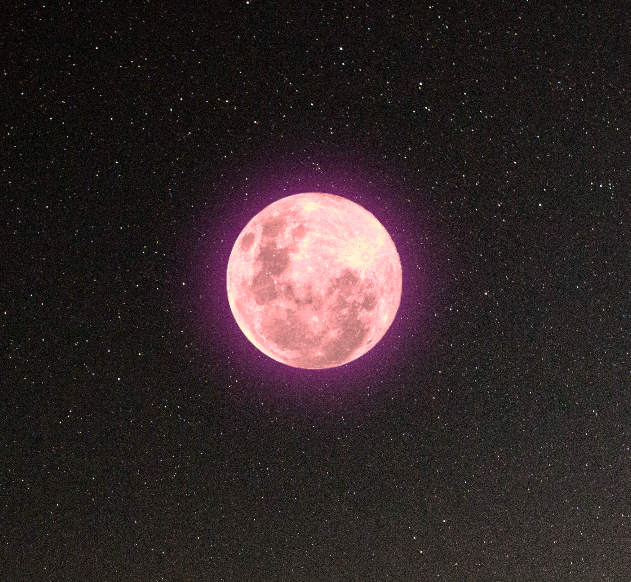

# 🌙 Moonlight

Página web interativa em que o usuário é convidado a clicar na lua para ativar efeitos visuais e luminosos em um cenário noturno estrelado.

🔗 **Acesse o projeto online:** [moonlight-woad.vercel.app](https://moonlight-woad.vercel.app/)

## 📸 Preview

## 🚀 Tecnologias Utilizadas

* **HTML5** — Estruturação semântica dos elementos da página
* **CSS3** — Estilização, halo luminoso e mesclagem da lua com o céu noturno
* **JavaScript** — Interatividade ao clicar na lua